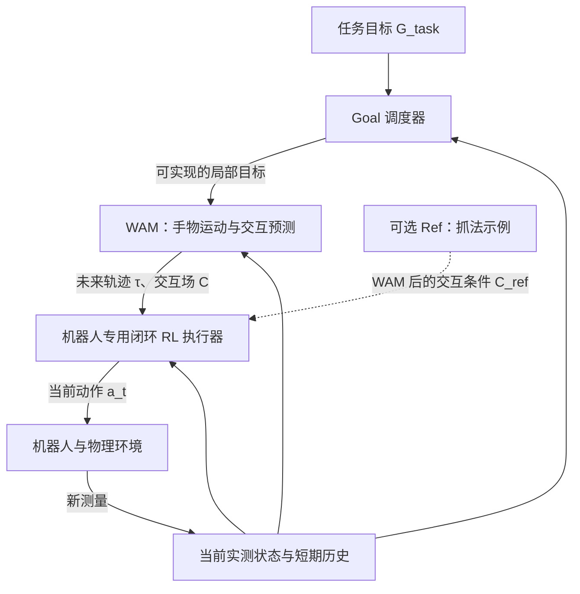

**我们目前定下来的总体架构是：任务目标 → 短期 goal 调度器 → WAM 预测手物运动与交互 → 机器人专用的闭环 RL 执行器 → 实际动作。Ref 保留为可选的抓法条件，放在 WAM 之后。**

这是目前收敛的**目标架构**。仓库已经实现了 WAM v4 和若干 executor 实验，但完整链路的控制效果还没有验证通过。当前仓库的总路线也明确写着：`G_task → realizable short goal → WAM → (tau, optional C) → executor → action`。[仓库总体路线](https://github.com/hitsz-oyx/Ref2Dex-agent/blob/74e353e4f9253acc20257de889af99b14b3d68f1/docs/research/20261017-wam-executor-experiment-map.md#L29-L54)

## 1. 整体结构

这里最重要的分工是：

| 模块 | 负责回答的问题 |
|---|---|
| **任务目标 \(G_{\mathrm{task}}\)** | 最终要让物体达到什么状态？ |
| **Goal 调度器** | 从当前状态出发，接下来这一小段应该完成什么？ |
| **WAM 的轨迹输出 \(\tau\)** | 在这个局部目标下，手和物体未来怎样运动？ |
| **WAM 的交互输出 \(C\)** | 未来什么时候、在物体什么位置、由手的什么部位发生接触？ |
| **可选 Ref** | 希望采用哪一种抓法或交互方式？ |
| **RL executor** | 根据机器人此刻的实际状态，现在应该发出什么控制动作？ |

## 2. Goal 和 Ref 的职责已经分开

### Goal 是任务条件，必须保留

我们之前明确过，要区分两个层次：

\[
G_{\mathrm{task}}
\;\xrightarrow{\;\text{Goal Scheduler}\;}\;
g_{t}^{(24)}
\]

- **总任务目标 \(G_{\mathrm{task}}\)**：例如把物体抬起并移动到指定位置、达到指定姿态。
- **局部目标 \(g_t^{(24)}\)**：从当前状态出发，在 WAM 接下来 24 个预测步内可实现的物体目标。

WAM 接收的是后者。调度器需要随着实际执行情况更新短期目标；仓库把这个“可实现的短目标桥接”列为尚需解决的核心问题。[短期目标与当前研究问题](https://github.com/hitsz-oyx/Ref2Dex-agent/blob/74e353e4f9253acc20257de889af99b14b3d68f1/docs/research/20261017-wam-executor-experiment-map.md#L15-L26)

### Ref 是可选的抓法条件

按我们此前确定的设计，Ref 表达的是“怎么抓”的示例，例如希望从哪个方向接近、采用怎样的手物接触关系。

**Ref 在 WAM 之后提供交互条件，WAM 主干仍保持 goal-conditioned 的手物未来预测。** 具体怎样编码、怎样和预测的 \(C\) 融合，还没有形成已经验证的最终实现。

因此，“不使用 Ref”只意味着关闭这一条可选支路，**任务 Goal 仍然存在**。

## 3. WAM 保留，当前落地版本是 v4

WAM 的总体接口可以写成：

\[
\left(
\hat{\tau}_{\mathrm{hand}},
\hat{\tau}_{\mathrm{obj}},
\hat C
\right)
=
\mathrm{WAM}\left(H_t,\;g_t^{(24)}\right)
\]

其中 \(H_t\) 表示当前手物观测及短期历史。

当前 v4 已经实现的结构是：

| 部分 | 当前设计 |
|---|---|
| 物体几何输入 | 目标物体的 **512 个表面点及法向** |
| 手输入 | **两只手各 11 个关键点**及相应历史信息，有效性由 mask 标记 |
| 目标输入 | 局部物体 goal |
| 主干 | PTv3 几何编码与共享 Transformer |
| 手轨迹输出 | 未来 **24 步**的手关键点运动 |
| 物体轨迹输出 | **32 个固定物体点**的未来运动 |
| 交互输出 | **128 个物体查询点 × 24 步 × 7 通道** |

交互场的 7 个通道是：

\[
C=
\left[
p_{\mathrm{contact}},
p_{\mathrm{palm}},
p_{\mathrm{thumb}},
p_{\mathrm{index}},
p_{\mathrm{middle}},
p_{\mathrm{ring}},
p_{\mathrm{little}}
\right]
\]

也就是接触置信度，加上六类手部位概率。当前 v4 的建模范围是目标物体与手，桌面、支撑面和其他物体的约束仍由执行端或后续规划模块处理。[WAM v4 架构合同](https://github.com/hitsz-oyx/Ref2Dex-agent/blob/74e353e4f9253acc20257de889af99b14b3d68f1/src/task/ptv3-shared-wam-v4/docs/ARCHITECTURE.md#L3-L42)

**这里要准确理解 \(C\)：它目前是交互预测场。** 它与轨迹头共享特征、并行输出，当前实现没有接收一条外部候选动作再预测该动作后果的接口。[v4 前向实现](https://github.com/hitsz-oyx/Ref2Dex-agent/blob/74e353e4f9253acc20257de889af99b14b3d68f1/src/task/ptv3-shared-wam-v4/src/ptv3_shared_wam_v4/model.py#L127-L168)

## 4. Executor 定位为机器人专用的闭环策略

执行端承担动力学、接触和实际控制，其目标接口可以概括为：

\[
a_t
=
\pi_{\mathrm{exec}}
\left(
s_t,\;
\hat{\tau}_t,\;
\hat C_t,\;
C_{\mathrm{ref}}^{\mathrm{optional}}
\right)
\]

这个式子表达的是总体设计，**当前 r3 / absolute-plan 实验还没有把这些条件全部接通**。

执行器每个控制步都重新读取机器人实际状态，包括关节位置、速度、当前手物关系等，再输出当前动作。以目前 Inspire 接口为例，它输出 12 个独立控制量，经过固定耦合映射形成 18 维原生命令。[执行器职责和动作接口](https://github.com/hitsz-oyx/Ref2Dex-agent/blob/74e353e4f9253acc20257de889af99b14b3d68f1/docs/research/20261017-wam-executor-experiment-map.md#L29-L45)

训练层面，我们保留的思路是：

- **BC 可以提供初始化**，让策略先具备基本动作能力。
- **RL 用来学习闭环任务完成**，包括接触建立、抓持稳定和偏离后的恢复。
- **执行后持续反馈**，WAM 与局部 goal 根据新状态更新；具体重规划频率需要结合控制与计算开销确定。

WAM 提供未来结构，executor 负责把这些条件转成适合当前机器人的动作。**\(C\) 作为执行条件是否有增益，仍需要匹配的对照实验。** 仓库也明确将 `state+tau` 与 `state+tau+C` 的比较列为独立验证项。[交互条件验证边界](https://github.com/hitsz-oyx/Ref2Dex-agent/blob/74e353e4f9253acc20257de889af99b14b3d68f1/docs/research/20261017-wam-executor-experiment-map.md#L24-L26)

## 5. 后果评价器、Plan Refiner、UniDexGrasp 的位置

这几个名称容易和主链路混在一起，当前定位如下：

| 项目 | 目前的定位 |
|---|---|
| **后果评价器** | 没有确定为当前每步执行的必经模块。若继续保留，它负责评估预测未来对任务是否有利，之后可以服务于计划比较与选择；当前 v4 的 \(C\) 不能直接等同于这个评价器。 |
| **Plan Refiner** | 按此前讨论暂缓，当前主链路直接由 WAM 条件进入 executor。 |
| **UniDexGrasp / 官方 PPO** | 讨论过作为无 Ref 抓取的训练或诊断底座。现有讨论不足以说已经确定用它替换整个方案；选择底座也不会自动改变 Goal、WAM 与 executor 的模块分工。 |
| **GT-\(\tau\)、BC、DAgger 实验** | 用于诊断执行接口与训练问题，其结果需要放回总体架构中解释。 |

项目的最终研究目标也仍然有两部分：**自行训练出有效的灵巧手策略，以及证明学到的短期手物交互表示对策略有真实增益。** 单独拥有预测网络或抓取策略，都还没有回答第二个问题。[项目 Mission](https://github.com/hitsz-oyx/Ref2Dex-agent/blob/74e353e4f9253acc20257de889af99b14b3d68f1/docs/MISSION.md#L5-L31)

所以，现在我们应当保持一致的架构表述是：

> **以任务 Goal 驱动短期目标调度，用 WAM 预测手物运动和交互结构，再由机器人专用的闭环 RL executor 产生实际动作；Ref 作为可选的抓法条件在 WAM 后接入。**

**已经确定的是这个分工。尚未验证完成的是短期目标调度、WAM 预测到实际控制的整链路，以及 \(C\) 对执行成功率的增益。**