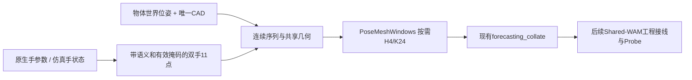

# 原生3D数据路线：架构、空间与审计

2026-10-14。本报告按[ref1](ref/ref1.md)推进，只使用已有连续3D标注或仿真执行。GB按十进制，GiB按二进制。

## 全量扩产更新

用户已取消400GB产物上限。下载、CPU转换和UniDex GPU4采集已实际并行运行；其他既有训练保持各自预算。

| 来源 | 全量扩产状态 |
|---|---|
| HOT3D | 849包全部下载，2.702GB压缩、9.069GB展开；424个记录中294有手物GT，290段/999,865时间步已转换，4段无QA通过时段跳过，0实现失败 |
| UniDexGrasp++ | 排除原20和官方TEST后2046新mesh，82批持续GPU采集、CPU审计；每mesh16条，总目标2066mesh/33056条，当前完成数见实时命令 |
| TACO | 物体位姿和模型下载完成；手包8线程Range续传，随后自动逐序列转compact，不完整展开原生pickle |
| HO-Cap | 复用旧Task的全部64段/72,944帧，已接入；保留外部测试用途，全部DEV，clock仍未核实 |
| DexYCB | 复用既有subject10全部100段/7,282帧，已接入；只读一个固定相机的原生3D标签，按官方s1属于TRAIN，clock待核实 |
| HOI4D / H2O | 已核实访问障碍并向用户请求所需下载能力/凭证；HOI4D四个几何相关包共24.19GB，无须RGBD |

上一版“HO-Cap/DexYCB尚未下载”遗漏了旧Task产物，本轮已找到并复用。[访问补查](../research/2026-10-14-native-access-followup.md)记录HOI4D/H2O/DexTrack现状与官方链接。

### 实时查看

在仓库根目录运行：

```bash
python3 src/task/3d-data-preparation/tools/audit/status_geometry.py
# 连续查看（每分钟）
watch -n 60 python3 src/task/3d-data-preparation/tools/audit/status_geometry.py
```

`outputs/3d-data-preparation/native3d-live-corpus-20261014-r1/manifest.json`每分钟更新完成分片引用；`progress.json`给各source和split的序列计数。只追加审计完成的UniDex批次，已完成的原生序列与CAD不改写；原pilot与full不重复计数。正式训练前要冻结索引并完成source准入，当前仍标记`training_allowed=false`。

各来源目录的`acquisition-status.json`或`progress.json`给实际PID、完成数、吞吐与时间；`tmp/3d-data-bulk-20261014-r1/`包含日志和launch receipt。SIGUSR1可请求HOT3D下载器在安全边界保留断点停止，UniDex队列的`STOP`文件在批次边界停止；未确认进程身份前不要直接kill。

全序列HOT3D名义30Hz最近邻对齐容忍≤16ms、保留真实时钟和残差，重复使用原始帧的时间步invalid；初始pilot仍≤2ms。HO-Cap/TACO/DexYCB尚无本轮已确认的原生30Hz时钟证据；不能把名义feature倍率当实测0.8秒预测。HO-Cap不进入TRAIN，DexYCB不把八路相机当八份独立动作。

## 初始样例结果（历史快照）

远端EgoDex下载器及旧GPU1/3重建已正常停止，数据保留；现有训练继续。新建稳定Task `3d-data-preparation`，在main上实现，未新建分支。

| 已接入来源 | 原始样例 | 工程窗口 | 实际状态 |
|---|---|---:|---|
| UniDexGrasp++ | 20物体、320条ShadowHand执行，现有数据只读复用 | TRAIN2560/dev640 | 所有窗口与旧接口比对，最大字段差2.98e-8；已通过共享collate |
| HOT3D | Aria P0001、Quest P0002；各512步、双手、6个场景物体 | TRAIN57/dev58 | QA/缺失掩码生效，时间对齐及完整CAD接口通过 |
| TACO | `(dust, roller, pan)/20230927_032`，221帧、双手、两物体 | TRAIN25 | 下载与FK转换完成，共享collate通过；30Hz假设尚待原生时钟证据 |

这些是工程接入结果，没有宣称多源预训练有效，当前所有manifest仍为`training_allowed=false`。新增人手窗口140个（TRAIN82/dev58），加现有UniDex共3340窗。5项物理合同测试通过。HOT3D两人划分同时区分设备，TACO只一条TRAIN且无独立dev，不能作为方法比较的正式验证集。

## 输入、数据合同和按需窗口



每段存一次`time/hand/hand_valid/object_poses/object_pose_valid/segment`，每个mesh-scale存一次CAD采样和固定32个query。窗口、每帧CAD、未来24步点云均在取batch时构造，避免大量重复存储。

当前anchor固定为**当前时刻目标物体的坐标系**。H4手、所有场景物体、法线、速度/加速度与未来标签都用这个固定anchor。未来物体缺失则mask无效，不填“静止”标签；episode/reset之间不连窗。上下文物体需要H4位姿完整，最多6个物体进入场景。

source_id4是原有ShadowHand/CAD；5预留TACO；6是HOT3D。人手profile和机器人profile显式保留。几何world-model监督与机器人action监督分开：UniDex的q/dq、root与60Hz命令在原始compact里仍可追溯，不能直接作为Inspire控制标签；人手MANO不是控制量。

HOT3D采用官方MANO15维PCA，左右手shape修正、wrist变换和米制保持与[官方FK实现](https://github.com/facebookresearch/hot3d/blob/main/hot3d/data_loaders/mano_layer.py)一致。没有使用图像估计手或物体。Aria取214-1流，最近邻对齐到30Hz，允许偏差≤2ms；本样例最大1.685ms。Quest本样例约1ns。原始timestamp、grid和偏差均留在NPZ中，最近邻重采样不是插值后的额外观测。

TACO保留00001–00221原生帧号。使用其[官方MANO fork](https://github.com/leolyliu/TACO-Instructions/blob/master/dataset_utils/manopth/manopth/manolayer.py)的`use_pca=false/flat_hand_mean=true/center_idx=0`，21关节点再取统一语义11点；mesh厘米乘0.01，手关节点毫米除1000后加原生hand_trans。两套官方reader的指尖顶点不同，profile明确区分。FK是小规模确定性几何计算，使用CPU，没有运行学习模型。

## 空间实测与估算

| 数据 | 纯几何下载 | 全解压大小 | 本路线的处理安排 |
|---|---:|---:|---|
| HOT3D Aria + Quest + Assets | **2.702 GB**，用户清单精确求和 | 全量尚未测 | 只取ground_truth、hand_data、assets；跳过main_vrs/MPS |
| HOT3D当前两段+全部Assets | **177.09 MB** | **236.32 MB** | 已实测，不外推全量解压比例 |
| TACO V1 | **15.690 GB** | **26.993 GB** | 压缩包与完整解压一起保留会到42.684GB；按序列转换避免这一峰值 |
| TACO当前一段 | **24.03 MB** ZIP成员payload | **34.35 MB** | 转换序列+两个几何NPZ共**99,947B**；不以单条样例承诺全量压缩率 |
| UniDexGrasp++ compact扩2066个TRAIN mesh | **约1.62 GB**轨迹，估算 | CAD/碰撞资产和原始批次另算 | 按当前16条/mesh、49.13KB/条线性估；不是5355物体全部可供policy |
| UniDexGrasp++ compact扩3084个TRAIN mesh-scale | **约2.42 GB**轨迹，估算 | 同上 | 同一mesh的不同scale必须同属一个split |
| HO-Cap几何 | **79.63 MB**，尚未下载 | **175.11 MB** | 另需每段meta.yaml；可作为后续小规模来源 |
| HOI4D / H2O | 尚未确认 | 尚未确认 | 前者分享读取失败，后者需用户身份申请；不据论文帧数承诺实际包大小 |
| DexYCB | 官方完整混合包约119G | 尚未确认 | 暂未核实官方轻量标签分包，避免整包下载 |

HOT3D的Aria有198条、Quest有226条清单项，不能等同424条都有监督GT；后续需逐项统计可用性。清单中两个main_vrs组共约715GB，均未选择。UniDex2026公开流程所说80TB包含RGB-D处理，不能套到本方案。

紧凑数组预计每真实时间步约0.4–1KB，再加共享CAD、原生控制/参数和索引。这是容量规划，不是全量转换测量；当前实现用4×4物体矩阵，额外字段与对象数会影响实际字节。TACO原生hand pickle约15GB主要不是我们所需的22点数组；转换后应显著缩小，但还须实测后估全量。

## 本地或远端训练（初始容量快照）

**建议本地完成reader和小规模审查，远端48GB GPU做后续多源训练；冷数据归档NAS，紧凑训练集放远端SSD。** 选择远端主要为了显存和现有训练环境，不是因为纯3D数据太大。

- 本地最近盘点可用约447–448GiB，每卡24GiB显存。
- 远端SSD最近可用259GiB，NAS约48TiB，每卡48GiB显存；视频重建释放了GPU1/3。实际开跑仍要重查占用。
- 全局产物监控约**346.4GB/400GB**，余量约53.6GB；NAS物理剩余大不意味着可以突破全局工作产物预算。
- 全量TACO的archive+unpack42.7GB已经接近当前余量，再加HOT3D及持续训练输出会挤占预算。因此按来源/序列分批、转compact并共享模型，不做一次全解压。

**不建议现在直接启动全量多源微调。** 下一轮要先核对目标操作语义、source采样/normalization，再做GPU模型前向反向与有限扩量；训练所用来源/参数仍由Probe决定，不能从工程接入推导收益。

## 自己审查的入口

所有路径相对仓库根目录：

- `outputs/3d-data-preparation/route-switch-20261014-r1/`：停视频证据、远端容量和HOT3D清单空间统计。
- `outputs/3d-data-preparation/hot3d-native-pilot-20261014-r1/download-summary.json`：实际选取的5个包、完整类型求和，不含签名URL。
- `outputs/3d-data-preparation/hot3d-posemesh-pilot-20261014-r1/`：manifest、序列、共享几何、conversion-audit、provider-audit和**geometry-review.png静态3D审查图**。
- `outputs/3d-data-preparation/unidexgrasp-index-20261014-r1/`：原有320条执行的新索引与旧reader比对报告，不复制源数据。
- `outputs/3d-data-preparation/taco-native-pilot-20261014-r1/`：官方ZIP精确Range取得的小样例与下载进度。
- `outputs/3d-data-preparation/native-mixed-pilot-20261014-r2/`：复用HOT3D并加入TACO的manifest、221帧序列、provider-audit；`geometry-review-source5.png`专看TACO，dev面板明确显示没有该来源的独立dev。
- `tmp/3d-data-switch-20261014-r1/`：下载、重试、转换与审计日志。

优先看静态图是否出现左右手颠倒、手物尺度不对或坐标错位；再看目标是否真是任务相关物体。当前HOT3D目标取metadata第一个物体仅用于工程测试：Aria目标为dumbbell，可能与手正在操作的物体不同，**这一选择尚不能作为任务goal准入**。代码/数值合同由自动审计负责，人工主要判断语义、实际几何与后续训练目标。

仍待确认：TACO原生时间的证据、两套官方MANO reader的指尖定义差异、目标选择、正式参与者/mesh分组、物理动作微调合同及GPU工程接线。当前成功与失败仿真轨迹都保留，不按末帧或一次视觉结果隐式筛选。

本轮重试记录均保留：HOT3D初次因两个ZIP同含license.txt停下，修复为仅接受字节相同的重复成员后续传；TACO官网网络间歇超时按已完成成员恢复，转换首次发现外部editable包的导入路径不完整，仅修正进程内package查找后r2成功，未修改外部仓库。失败的mixed-r1没有manifest，不作为可用语料。
