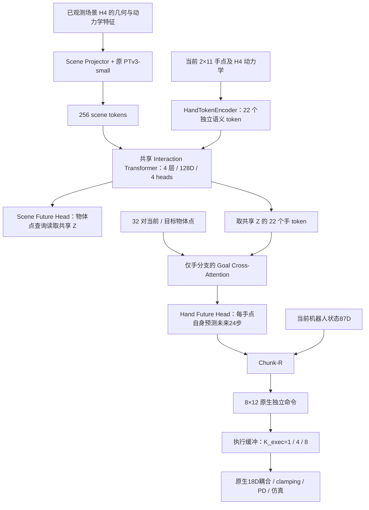

# PTv3-Shared-WAM：当前实现架构

依据：[ref1.md](ref/ref1.md)。实现日期：2026-10-13。
这是独立 Task 的 supervised baseline；代码 schema 为 `ref2dex.ptv3-shared-wam.v1`。
当前已实现模型、三域预训练、机器人联合微调、可选 human replay、DDP、checkpoint
恢复以及原生仿真的 chunk 执行入口。工程验证与后续科学实验须分开解读。

## 1. 核心计算图

公式为：

\[
Z=F_{shared}(S_{\le t},H_{\le t}),\qquad
\hat U=D_U(Z;P_t),\qquad
\hat V=D_V(Z,G),\qquad
\hat A=R(s_t,\hat V).
\]

`P_t` 是当前物体采样点，用来确定 scene head 的读取位置，不含未来信息。
两个 head 的交互上下文均来自共享 Z；scene head 没有绕过共享 trunk 的 PTv3
feature skip。没有 `V → U`、`G → Z` 或 `G → U` 路径。

**ref1 开头示意图与后文的歧义处理：**以第7/18节及最终公式为准，object goal 只进入
手预测分支；R 接收当前机器人状态和预测轨迹，不另接 goal。
第一版沿用现有 Chunk-R 的87D状态合同；包含 q/dq、手与物体几何和物体速度，
没有新增 previous-command 维度。robot proprioception 不进入共享预测器。

## 2. 输入、坐标与掩码

所有预测使用同一个**当前 anchor frame**，单位为米。历史帧、当前手点、当前场景点和
计划 goal 都先转换进这个坐标系；未来不能单独重新居中。

| 字段 | 张量 | 用途 |
|---|---|---|
| `xyz` / `features` | B×P×3 / B×P×18 | 当前场景几何、法线、历史动力学和已有元数据 |
| `point_valid` | B×P | 可变长度场景的当前点掩码 |
| `start_hand` | B×2×11×3 | 当前手点坐标 |
| `start_hand_history` | B×2×11×9 | H4 速度、加速度、三步位移 |
| `start_hand_valid` | B×2×11 | 当前语义手点有效性 |
| `scene_points` | B×O×32×3 | 每个物体当前固定采样点 |
| `start_object_points` / `goal_object_points` | B×32×3 | 同一组物体点的当前与目标位置，仅手分支使用 |
| `object_goal_valid` | B×32 | goal 点掩码；全缺失时不加入 goal residual |
| `native_state` | B×87 | 仅机器人 R 使用 |

H4 在30Hz上表示当前和前三帧。启动时重复已有初帧，沿用其他 Task 的历史合同。
手顺序是 **right、left**；每手语义顺序为 wrist、五个 MCP、五个 fingertip。
机器人单右手时左手全部缺失，不用零坐标冒充有效点。

未来 `action`、`effect`、轨迹标签和监督有效性掩码均不进入共享编码器。
无效观察在进入 MLP/attention 之前清零，避免 NaN 通过梯度污染有效参数。
填充物体和缺失手的预测输出为零，loss 仍按显式掩码排除它们。

## 3. 场景编码与共享交互层

复用 `goal-point-wam` 的 `SceneHistoryEncoder` 所构造的 **原 PTv3-small**，
不修改 vendor 的层数、通道、stride 或注意力结构。场景投影仍为18→128→128。
继承类移除没有使用的旧 object projector，避免遗留未参与训练的参数。

- 1cm 固定 voxel，origin 为 `[-2,-2,-2]`，沿用序列化空间边界。
- 在 voxel 聚合前通过 hand marker 排除手点；手与场景不会聚合在同一 voxel。
- 沿用既有4096点 cap及物体保留策略，再从有效场景点等间距选取最多256 token。
- scene token 附加当前XYZ的位置编码及 scene type embedding。
- hand token 由12D观察 MLP、hand ID、keypoint ID及 hand type embedding组成。
- 256 scene +22 hand 拼接成278 token，进入4层128D/4heads/FFN512的共享 self-attention。
- PTv3训练保留原 stochastic depth和序列化顺序随机化；eval关闭顺序随机化。

没有手工输入 fingertip-object 距离或接触对应关系。物体 ID 只用于场景/标签组织，
没有规定某根手指必须关注某个物体。

## 4. 双预测头

**Scene head：**每个物体32个当前点的XYZ通过位置 MLP形成 query，cross-attend
全部共享 Z，再通过时间 embedding 和 MLP预测位移：

\[
\hat U\in\mathbb R^{B\times O\times24\times32\times3}.
\]

它预测已跟踪物体点，不声称当前已经覆盖全部背景 dense points。
未来 EgoDex dense tracks 属于另一次明确的数据与解码接口扩展。

**Hand head：**直接取共享 Z 的22个手 token，读取 object goal 后，每个 token
加上24个时间 embedding，通过同一个 MLP预测自身的未来位移：

\[
\hat V\in\mathbb R^{B\times24\times2\times11\times3}.
\]

不再使用528个独立 hand/time query 去从头读取 scene memory。手点身份从输入到输出持续保留。
两预测头最后一层使用小的非零初始化，以便首步 hand/scene loss 就能进入共享 trunk和PTv3。

## 5. 三域数据与预训练损失

复用原 `MixedWindows`、TRAIN/dev切分、source/category sampler和 TRAIN normalization。
原始三域文件不重写。数据源保持 OakInk2/GRAB/ARCTIC，source 权重为5:2:2。

当前32个 object point ID在所有24个未来步保持一致。现有 `effect` 是当前 anchor frame
中的物体相对变换，对当前点作用后生成标签：

\[
U^*_{o,j,i}=R_{o,j}P_{o,i}+t_{o,j}-P_{o,i}.
\]

手标签沿用实际手运动相对当前手位置的位移。当前物体 endpoint作为 hand goal；
这个 goal 不用于 scene forecast。

损失是分别归一化的坐标 MSE：

\[
L_{pretrain}=\lambda_H\overline{L_H}+\lambda_S\overline{L_S},
\quad \lambda_H=\lambda_S=1.
\]

两项均除以固定0.05m尺度后计算 MSE，分别按自己的有效点/步归一化，不将所有scene和hand
点混在一个分母里。scene 的运动权重使用当前到未来的点位移幅度，阈值2mm、静态权重
floor0.1、sigmoid temperature5；静止物体仍有非零监督。
当前没有为 fingertip 单独乘大权重。

初始化加载已有 PW step50000 的 PTv3、scene projector和场景归一化；新增模块随机初始化。
这是空间编码器权重迁移，不声称复现原PW的action-conditioned temporal forward。
AdamW参数组：场景/PTv3 `1e-5`，其他模块 `1e-4`，weight decay0.01、clip grad1。
整个预测器均可训练。

评估分别报告各source的 hand first8/all24、scene all24/h24，以及 moving/static scene EPE。
缺失类别报告 `null` 和有效点计数，不能当作零误差。

## 6. 机器人联合微调

第一阶段使用现有已通过 readiness/audit 的完整 airplane teacher demonstrations，
从实际FK手点、实际物体位姿和**同一行实际执行命令**构造 `(s,V*,U*,a*)`。
当前帧t的轨迹标签是状态t+1…t+24；动作标签是命令t…t+7。
goal来自已知计划 reference[t+24]，不从演员未来的实测物体位置构造。

TRAIN为完整env0…15，dev为env16…23。它们仍来自同一运动、固定初态的演示，
不是跨运动或扰动泛化证据。含clipping的24步窗口不准入，归一化仅用TRAIN行。

沿用128D Chunk-R：

| 输入/输出 | 合同 |
|---|---|
| 当前状态 | 87D：q18+dq18+当前物体坐标下的手点33+world物体pose12+物体速度6 |
| 手轨迹 | 24×33，右手、native link顺序、同一当前物体坐标系下的位移 |
| 输出 | 8×12 独立 native command |
| 原生执行 | 扩展到18D耦合命令并clamp；保留原 PD 转换，指关节尺度按原控制器处理 |

WAM语义点到native link的重排沿用 `WAM_TO_NATIVE`。没有新的形态坐标拟合。
R可以从TRAIN统计初始化，也可以通过 `--init-r` 显式加载已有匹配controller的Chunk-R。

机器人损失：

\[
L_{robot}=L_H+L_S+L_{A,\hat V}+L_{A,V^*}.
\]

两项action loss均为按R的TRAIN action std标准化后的8×12坐标平均L1，系数1。
`R(s,V_hat)` 的梯度进入整个shared forecaster和R；`R(s,V*)` 的GT锚定梯度只进入R。
PTv3、HandTokenEncoder、interaction、双预测头、goal conditioner和R一起更新。
不加载旧 action-conditioned World，不使用effect-consistency loss。

初期默认 `replay_fraction=0`，做机器人单任务适配。后续配置可开启human replay：
每步另外采样三域batch，按 `(1-r)*L_robot + r*L_human` 混合；human没有机器人动作损失。
未把失败演员后续运动标成expert trajectory；学生状态纠偏采集不是本次V0数据入口。

## 7. Chunk执行、身份与资源

原生执行使用两个独立runtime：graspenv运行完整Shared-WAM/R，归档torch2.0.1环境运行
IsaacGym。双方通过有大小上限、PID核对的本地JSON Unix socket通信。

默认 `K_exec=4`，可选1/8。查询输出8条命令后执行前K条，只有buffer耗尽才重新查询。
存储实际query tick、chunk index、命令、clipping、PD target和实际手/物状态。
这是同步前K步缓冲，没有复刻PointWAM的异步30步队列。

三行独立执行：teacher calibration、GT轨迹/R calibration、Shared-WAM/R。
GT手轨迹只进入校准行，不进入演员；演员仅使用自己实测H4和计划object goal。
完整542步报告hold/drop/placement；短工程smoke不评价抓取成功。
独立数组audit复算PD转换、chunk时钟、自己的查询历史与held帧数。

新schema保存整个模型，而非旧WAM的decoder patch。机器人checkpoint同时保存forecaster与R，
避免互换不匹配的pair。每个 `stepN.pt` 都是独立文件，保存优化器和每rank RNG以供resume。
DDP使用NCCL同步梯度，各rank独立采样；`batch_size`是每rank大小。

输出在 `outputs/ptv3-shared-wam/<run_id>/`，scratch/cache在项目 `tmp/`。
训练有固定更新次数/时间上限，记录GPU显存、利用率与ETA；运行中源码变化或陌生GPU进程
使本任务停止。共享GPU上限6张、产物上限400GB；训练单run额外上限4GB，物理执行1GB/600秒。
非工程运行须先给Task-local experiment card和全局seed。工程checkpoint不静默升级为科学初始化。

## 8. 文件对应

| 文件 | 责任 |
|---|---|
| `src/ptv3_shared_wam/scene.py` | 保持PTv3结构，排除hand voxel，输出scene tokens |
| `src/ptv3_shared_wam/model.py` | 手token、共享trunk、goal隔离、双预测头 |
| `src/ptv3_shared_wam/data.py` | 三域复用、32点SE(3)标签、collate与掩码 |
| `src/ptv3_shared_wam/objectives.py` | 独立归一化MSE和分域/运动指标 |
| `src/ptv3_shared_wam/robot.py` | 实际机器人标签、native语义映射、联合R和GT anchor |
| `src/ptv3_shared_wam/training.py` | 两阶段单GPU/DDP训练、梯度审查、评估和恢复 |
| `src/ptv3_shared_wam/checkpoint.py` | schema、完整checkpoint和产物预算 |
| `src/ptv3_shared_wam/execution.py` | 1/4/8步buffer的查询/执行合同 |
| `tools/run/train_pretrain.py` / `train_robot.py` | 两阶段训练CLI |
| `tools/run/launch_native.py` / `policy_server.py` / `execute_native.py` | 拥有两个runtime的原生执行入口 |
| `tools/audit/audit_native.py` | 保存轨迹的独立数组审计 |
| `tests/test_shared_contract.py` | 泄漏、掩码、共享梯度、GT锚和buffer语义 |

## 9. 当前验证与结论边界

已进行CPU合同测试和真实三域/PW初始化的GPU四步工程预训练，以及真实机器人标签的四步
联合微调和短原生执行接线。当前14个合同测试通过；双卡预训练及双卡robot+25%human
replay分别完成4步。两项forecast loss均进入PTv3/interaction，predicted-action loss进入
forecaster与R，GT锚定对forecaster梯度为0。
完整预测器51,474,054参数，包含R的pair52,057,490参数；PTv3及scene projector
迁移50,436,224参数。双卡smoke采样显存约1.7GB/卡。
从step2恢复到step4与连续训练的参数最大差 `3.47e-7`。
原生K=1/4/8分别完成4/8/16controls，peer正常退出，数组审计通过。
具体run目录在[README](../../README.md)中注明。
这些检查验证模型接法、梯度与原生执行，不证明已经学会抓取。

后续依ref1顺序推进三域Probe、airplane机器人适配、混合replay和固定checkpoint的
K_exec比较。旧架构matched对照、完整背景dense预测及Residual PPO接入仍属于后续实验。
旧counterfactual World在原Task独立保留，不参与本baseline的任何梯度路径。
