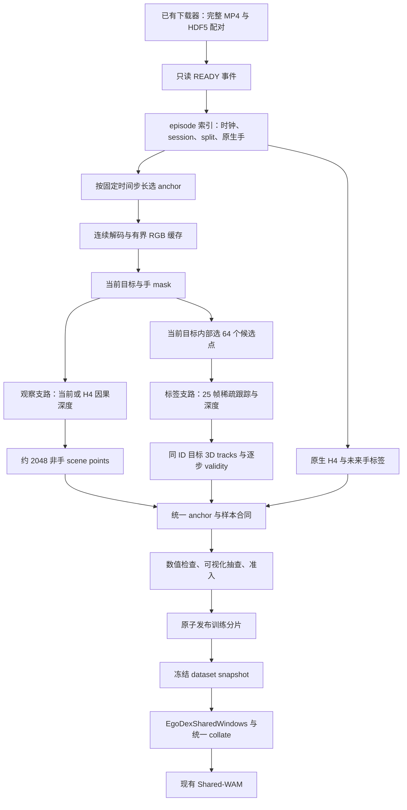

# EgoDex → PTv3-Shared-WAM 数据处理架构（初稿与首版实现）

日期：2026-10-13。依据：[处理思路 ref1.md](ref/ref1.md)、[Shared-WAM 当前架构](../../../ptv3-shared-wam/docs/user/架构.md)及相关源码。

2026-10-14 补充：[其他数据集接入调研](../research/2026-10-14-shared-wam-dataset-survey.md)。大规模扩量重点是Open-AoE、EgoSuite、EgoVerse、WIYH，以及EgoSteer的部分手监督候选；仍须原生字段/世界系检查和物体标签生成。H2O/HO-Cap/DexYCB作为小集校验，可用新provider由原生RGB-D和物体SE(3)生成几何标签。规模、实际发布与接入缺口见调研文档。

本文设计在远端随下载进度分批加工 EgoDex，产出可供 Shared-WAM 人类视频预训练的数据。用户授权实现后，已落地 geometry-only 的数据生成、分片、恢复和独立训练接入；实现状态见第 16 节及 [Task README](../../README.md)。未启动远端任务或修改现有三域主训练入口。目标是先建立可信、可扩展的数据闭环，再决定扩规模，而不是复刻 PointWAM 的完整重建合同。

## 1. 推荐方案与取舍

推荐采用 **当前稀疏场景 + 原生手部历史 + 目标物体稀疏未来轨迹**：

\[
(S_t,H_{t-3:t},G_{t+24})\longrightarrow(U_{1:24},V_{1:24}).
\]

- `S_t`：约 2048 个当前非手场景点，作为 PTv3 感知上下文。
- `H`：EgoDex 原生双手各 11 个语义点，历史 4 帧。
- `U`：一个明确目标物体或可动部件，固定 32 个点的未来 24 步位移。
- `V`：原生手点的未来 24 步位移。
- `G`：上述同序 32 个目标点的当前位置与 `t+24` 位移。

首版保持 `O=1`、30 Hz、H4、horizon 24；手和场景分别监督，不生成机器人动作。模型仍使用现有 PTv3、22 个 hand token、32 个 goal token 和共享双头。

| 路线 | 优点 | 成本与局限 | 本轮选择 |
| --- | --- | --- | --- |
| 当前场景几何 + 稀疏目标跟踪 | 跟踪量小，最快建立适配闭环 | 场景速度等特征缺失；仍需可靠深度 | 首版 `geometry-only` |
| H4 场景短跟踪 + 稀疏目标跟踪 | 更接近三域的观察特征 | 加入 1k–4k 点的历史跟踪与深度一致性检查 | 合格数据上再做最小对照 |
| 全场 dense tracks + 长片重建 | 可保留广泛的未来监督 | 跟踪、深度、缓存昂贵；当前模型不需要全部标签 | 不作为新流水线默认路径 |

`geometry-only` 将 scene 的速度、加速度、历史位移填零，表示该 profile 未提供运动特征；不代表世界静止。手部仍提供完整 H4。它是需要验证的预处理简化，不能先断言与 H4 版本等效。

与全场重建相比，主要节省的是跟踪、轨迹存储和重复加工。**只在 64 个像素读取深度，并不意味着深度网络只计算 64 个像素**；depth backend 仍可能是主要耗时。

## 2. 仓库事实与可复用边界

| 已有内容 | 可以复用 | 必须补充或调整 |
| --- | --- | --- |
| `ptv3_shared_wam/data.py::SharedWindows` | 现有样本语义、endpoint→delta 转换 | 当前只接受 OakInk2/GRAB/ARCTIC；新增 EgoDex provider |
| `point_labels()` | 32 点、24 步输出形状 | 它要求刚体 `effect`；EgoDex 直接读取 3D tracks，不走此函数 |
| `shared_collate()` | 统一模型输入及显式掩码 | 当前经 `goal_collate` 和旧 base collate，依赖 `points/effect/action` 等传输字段 |
| `goal_point_wam/data.py::_cap_scene` | 点数上限与目标保留思路 | 当前将所有负 ID 当作 hand，且每物体最多保留 512 点；直接接入背景会破坏 cap |
| `ptv3_shared_wam/scene.py` | 原 PTv3、1 cm voxel、最多 256 scene token | 它实际按 `features[...,14]` 排除手，并不要求所有输入点都有未来标签 |
| `forecast_loss()` | 逐点逐时间 mask、独立手/场景 MSE | 只传入真实可用监督；以后若加质量权重，作为独立协议记录 |
| 原生 EgoDex 手部适配 | 11 点名称映射、30 Hz 检查、confidence 处理 | 旧 hand-only auxiliary batch 没有非手 scene，不能直接送入新 SceneEncoder |
| 远端下载 ready 队列 | 已完成 MP4/HDF5 配对的增量通知 | 新 consumer 使用独立 ledger，不消费或改写旧 consumer 的状态 |
| 旧 VGGT-Omega/CoTracker 流程 | 已有模型资产、解码和标定经验 | 旧流程有 10 Hz 重建、插值及 offline observation，不能原样当作本合同 |

相关实现：[Shared-WAM 数据层](../../../ptv3-shared-wam/src/ptv3_shared_wam/data.py)、[场景编码](../../../ptv3-shared-wam/src/ptv3_shared_wam/scene.py)、[旧 cap/collate](../../../goal-point-wam/src/goal_point_wam/data.py)、[原生手准入](../../../goal-point-wam/tools/audit/prepare_egodex_actor.py)、[旧重建 consumer](../../../goal-point-wam/tools/run/reconstruct_egodex_queue.py)。

已有[视频目标审计](../../../goal-point-wam/docs/experiments/probes/P-20261013-goal-point-wam-video-object-goal.md)发现：部分数值合格轨迹来自桌面/底座，实际操作的是独立部件；移动瓶子等目标又缺少足够跟踪点。因此新流程须先确定目标表面，再主动在其内部补点。该历史卡的 World-goal 隔离属于旧架构；本 Task 沿用当前 Shared-WAM 的 **goal 同时条件化 U/V**，不能照搬旧模型路由。

## 3. 总体数据流



运行粒度是 episode 或连续 episode block，训练读取粒度是 window。重叠窗口共享解码、原生手数组和可复用推理结果；不逐 window 启动进程、加载模型或另存一套原始视频。

观察与标签是两条数据依赖不同的支路。未来帧可用于生成 `U/V/G` 和标签质量 mask；当前 scene、手历史、目标身份与采样点只能由 `≤t` 的信息决定。

## 4. 原始数据索引、时间与 split

官方数据提供 30 Hz 配对视频、相机内参、相机及关节在 episode 固定世界系中的 transforms；关节 confidence 可缺失，语言描述位于 HDF5 attributes。世界原点不跨 episode 共用。见 [EgoDex 官方说明](https://github.com/apple-aiml-research/ml-egodex#dataset-structure)。

`EpisodeIndexer` 首先读取轻量信息，不运行视觉大模型：

- 来源 archive/part、task、member、episode ID、MP4/HDF5 路径与已有下载完成记录。
- `transforms/camera`、`camera/intrinsic`、手点、confidence、session 与语言 attributes。
- 视频 FPS、帧数/时间戳与 HDF5 长度；不一致记录进入隔离队列，不能默默截断后宣称对齐。
- 可用 anchor 满足 `3 ≤ t ≤ N-25`，索引区间为 `[t-3,…,t+24]`，共 **28 帧**；未来跟踪区间 `[t,…,t+24]` 共 **25 帧**。

首批建议 anchor stride 8，即每约 0.267 秒一个窗口。stride 只控制窗口密度，不改变每个窗口内部 30 Hz 的时间；不先降为 10 Hz 再插回去。目标切换、遮挡或短片可减少窗口，无需一开始密集覆盖所有帧。

仅从 official TRAIN 构建训练与内部 dev；official TEST 保持独立。优先沿用已确认的 session 分配，不按窗口随机切分。若缺 session，按完整 recording 分组并记录无法保证跨 recording 去重的限制，不根据相似 task 名猜测 session。新增数据的分组归属采用稳定 split registry，不随下载进度重新划分。

生成数据允许持续新增；一次训练只读取冻结的 `snapshot_manifest`，固定 shard 列表、split、profile、统计和抽样规则。新 shard 在下一次训练/适配 run 才进入，避免恢复 checkpoint 时数据分布悄悄变化。

## 5. 原生手：直接映射，不重建或 retarget

手顺序固定 `right, left`；每手顺序复用现有 EgoDex adapter：

```text
Hand
ThumbKnuckle / IndexFingerKnuckle / MiddleFingerKnuckle /
RingFingerKnuckle / LittleFingerKnuckle
ThumbTip / IndexFingerTip / MiddleFingerTip / RingFingerTip / LittleFingerTip
```

读取 `transforms/<side><suffix>` 的 translation，得到 `[N,2,11,3]`。这里使用 dataset 的实际关节名称，不生成近似 palm points；尤其不要把拇指 `ThumbKnuckle` 的命名理解成无需检查的解剖学等价关系。

首批沿用 confidence ≥ 0.5 的保守配方，并记录这是本项目阈值。confidence 缺失的 recording 先隔离，不把缺失自动当作全有效；之后是否启用无 confidence 子集再单独决定。无效点存零和 false mask。

在同一个当前 anchor 中计算：

\[
v_t=30(h_t-h_{t-1}),\quad
a_t=900(h_t-2h_{t-1}+h_{t-2}),\quad
d_t=h_t-h_{t-3},\quad
V_k=h_{t+k}-h_t.
\]

首版沿用现有保守规则：某手点 H4 任一帧缺失，则该点观察与对应 future supervision 都无效，避免缺失历史产生虚假速度。其余手点按各自 future confidence 逐步屏蔽，不要求双手全部 22 点在 28 帧上都完整。

EgoDex 没有本项目机器人的 q/dq/执行命令；数据包不伪造 `native_state/native_action`，只进入 human forecasting loss。机器人动作映射与微调仍使用原 Task 的真实机器人数据。

## 6. 目标物体：语言作候选提示，视觉确认具体表面

语言可以帮助回答“杯子还是抽屉”，但不能直接提供 mask、point ID、米制轨迹或期望 endpoint。首版链路是：

```text
task 名 + 有效语言描述 → 少量对象/部件候选
当前 RGB + 当前/历史手位置 → 候选框与 mask
mask 纯度、手邻近关系与已观测交互 → 唯一 target slot
```

语言字段读取遵循 `which_llm_description`；官方说明这些自动描述可能有误，因此只作弱提示，不作为真值。见 [EgoDex language metadata](https://github.com/apple-aiml-research/ml-egodex#dataset-structure)。首批优先已下载的简单 pick/place、杯子或瓶子搬运；下载顺序仍由已有 producer 管理，不为分类另拉完整归档。

`TargetSelector` 封装可替换的文本 grounding、mask 分割和视觉打分；首批可用少量人工确认 mask，先验证几何链路，再扩大自动化。模型资产可用性和实际候选准确率未核验前，不绑定必须安装的检测器组合。

- 框不能直接代替目标表面 mask；扣除 hand/forearm mask，并保守避开遮挡与边界。
- 优先选手附近且已观测到交互的候选；接触不是硬条件，保留合法的远手接近阶段。
- 桌子、灯具、抽屉等选择具体可动部件；部件不明确或同时操作多个独立物体时先延期。
- 目标身份在观察端固定，不能先看未来哪个物体位移最大再选目标。
- 手 mask 优先来自分割，关节投影仅作提示和保守排除，不能等价替代完整手轮廓。

同一交互片段内可用过去帧传播 mask，目标变化时重新 grounding。禁止用 future mask 回流修改当前观察 mask。保存目标名称、部件、选择来源、当前 mask、置信度及拒绝原因，以便区分“目标选错”和“跟踪失败”。

首版限定容易确认的刚性可见表面。软物体、透明/强反光物体、极小部件及严重长期遮挡先入延期队列；这是投入顺序，不是证明它们不能使用。

## 7. 深度、米制尺度与移动相机

这是最主要的可行性风险。原生手和相机已有 3D 标注，**物体的 metric depth 仍须估计和检查**。也不能直接在每帧相机坐标相减，那会把头部运动算作物体运动。

### 7.1 两种深度用途

| 支路 | 输入允许范围 | 输出 | 建议首版方式 |
| --- | --- | --- | --- |
| observation depth | 当前帧或过去 H4；标定也只能用已观测信息 | 当前 scene、当前目标点、normal | 先评估可用的单帧米制深度；不合格时使用 H4 因果深度方案 |
| label depth | 可使用 `[t,…,t+24]` 多帧 | 未来目标点及标签质量 | 优先复用已有 VGGT-Omega 资产的有界 block 推理，独立审查尺度 |

VGGT 官方接口提供 depth、相机和 point map 等输出；本方案只借鉴深度支路，坐标转换以 EgoDex 原生相机为准，不用预测相机替换原生相机。见 [VGGT 官方使用接口](https://github.com/facebookresearch/vggt#detailed-usage)。现有 Omega 工具是否支持所需因果/短 block 输入及显存规模，须在首批实际测量。

单帧模型是否足够准确尚无证据；这是候选工程后端，不作为已经完成的选型。已有整段 offline depth 可作标签或诊断参考，不能直接成为声称因果的当前 scene。若首批只能得到 offline observation，应单列 `causal_observation=false`、保留为诊断数据，不混进默认可训练快照。

### 7.2 统一坐标

设 `T_WC(k)` 为原生相机到 episode 世界系的 transform，`B` 为经投影核验的 depth camera→原生相机轴转换；深度为 optical-axis Z：

\[
q_k=D_k(u_k,v_k)K_k^{-1}[u_k,v_k,1]^\top,\qquad
p_k^W=T_{WC}(k)Bq_k.
\]

`B` 必须根据实际后端和原生投影约定验证；不能仅因“ARKit”就盲目套一个翻轴矩阵。若后端输出的是射线距离，先转换为 Z-depth。resize/crop/letterbox 同时更新 K 和 UV，避免把缩放后的像素配原始内参。

推荐当前 anchor 为 **当前目标可见点中心 + 固定的重力对齐轴**：平移由当前目标几何决定，朝向由已核验世界重力与当前相机水平朝向决定，必要时使用预定义稳定朝向。它让 EgoDex 接近三域的目标附近局部坐标，又无需不存在的物体 SE(3)。

令该坐标变换为 `T_AW(t)`：

\[
p_k^A=T_{AW}(t)p_k^W,\quad
h_k^A=T_{AW}(t)h_k^W,\quad
U_{k,i}=p_{t+k,i}^A-p_{t,i}^A.
\]

全体历史、当前、未来和 goal 使用 **同一个 t 的 anchor**，只居中一次；不同未来帧不能重新居中。未来相机用于标签 lifting 是允许的，未来相机不能进入 observation feature 或当前标定。坐标轴/profile 明确登记，与三域/机器人混训前检查方向与数值分布。scene 保持现有 `voxel_origin=[-2,-2,-2]`、1 cm voxel，并通过实际 `fixed_workspace_grid` 的范围检查；不是仅用一个假定的 ±2 m 包围盒代替源码边界。

### 7.3 尺度校准与漂移

候选 metric calibration 可利用已观测原生手点与其投影深度，以及已知相机运动下可信静态背景的一致性。每种后端先检查它需要 scale 还是 scale+shift；不一律按单一倍数修复。

原生关节不恰好位于可见皮肤表面，EgoDex 合成 RGB 也有投影视角偏差；手点采样只能作为有误差的约束。官方提示见 [EgoDex reprojection example](https://github.com/apple-aiml-research/ml-egodex#code-structure-and-installation)。低置信、遮挡、轮廓边界点不可拿来强行标定。

记录标定支撑数、残差、跨帧/跨 block 尺度变化，以及静态背景补偿后的虚假位移。相机平移极小、原生手遮挡或约束不足时，标定可能不可辨识，窗口直接标为 `UNCALIBRATED`，不不断扩大重建直到偶然通过。

观察和标签最终都必须落在同一个原生米制世界中；不能各自独立归一化后相减。track 的当前点直接采用 observation 当前深度，未来采用校准后的 label depth，同时额外检查两个支路在共享当前帧上的原始几何一致性。不能通过把 `t` 标签硬设为观察位置掩盖尺度分歧，也不能用窗口未来拟合出的校准参数回写 observation。

## 8. 场景点与 18D feature

首版 `N_scene=2048`，允许有效点数量变化，最多 4096。先过滤手/前臂、非有限深度和工作区外点，再体素去重和分层采样。初始配额建议：

| 来源 | 2048 点初始配额 | 用途 |
| --- | ---: | --- |
| 目标表面 | 512 | 保留操作对象，包含 32 个 query 当前点 |
| 手与目标附近的非手场景 | 1024 | 局部支撑面、障碍与交互几何 |
| 更广的当前背景 | 512 | 桌面及周边上下文 |

区域互斥去重，不足配额从其他有效区域补；仍不足则用可变长度和 padding，不重复点伪造密度。候选 query 点保留优先级最高。可先用简单 voxel+均匀采样，没必要对整幅百万像素点云反复 FPS。

准确沿用当前 18D feature 索引：

| 列 | 含义 | EgoDex 填法 |
| --- | --- | --- |
| `0:3` | normal | 当前点云邻域估计、统一朝向；无法估计时零并记录比例 |
| `3:6` | velocity | geometry-only 为零；H4 profile 从短 track 计算 |
| `6:9` | acceleration | 同上；必须先通过噪声检查 |
| `9:12` | 三步 displacement | 同上 |
| `12` | target marker | target mask 内为 1，其余 0 |
| `13` | observed static marker | 仅有可靠历史证据时填 1；geometry-only 保守填 0 |
| `14` | hand marker | 所有保留的非手 scene 为 0 |
| `15:17` | hand ID、keypoint ID | 非手 scene 为 0 |
| `17` | local instance ID / 32 | 首版 target slot 0；context 无对象身份，填 0 |

`scene_object=0` 表示目标；`-2` 表示 context-only；`-1` 保留旧 hand 语义，padding 由 `point_valid=false` 排除。context 不加入 `object_valid`，也不产生未来静止标签。不要把 `features[13]` 的 scene static marker 与 `object_features[13]` 的 target marker 混淆。

H4 增量版对当前选中点仅使用 `[t-3,…,t]` 反向短跟踪；不能在含 future 的整段 tracker 上截取历史输出。深度都转换到共同世界系后计算动力学，背景也不能因“看起来静止”跳过相机补偿。

短跟踪失败时对应运动 feature 为零，另存 `scene_motion_valid`，不得扩大当前点缺失 mask 来掩盖未来跟踪失败。当前网络不读这个新 mask；geometry-only/H4 是明确的 dataset profile，缺失运动与真实零运动的歧义作为局限记录。若歧义影响训练，再设计 feature contract 扩展，不在初稿就改网络维数。

复用当前模型统计时统计保持冻结；若需要重新拟合，只使用目标训练快照中的 TRAIN，并在新的适配 run 中明确采用。geometry-only 与原统计的偏差须先看分布和短 smoke；不修改正在跑的三域训练统计。

## 9. 目标跟踪、遮挡与 endpoint goal

`TargetTrackBuilder` 从 **当前 mask 和当前深度** 选择约 64 个空间分散候选点，保守腐蚀边界，排除手与深度断层。随后按当前空间覆盖确定固定 32 个模型 query；额外候选供质量诊断和下一轮采样策略使用，不用未来可见性挑“幸存的 32 个”。

CoTracker sparse queries 使用 `(frame_index,x,y)`，返回 tracks 和 visibility；可以处理当前帧起始的稀疏点。见 [官方 predictor](https://github.com/facebookresearch/co-tracker/blob/main/cotracker/predictor.py)。首版目标标签使用 25 帧连续 RGB，保持同一 query ID；离开画面、遮挡或深度失效的时间步显式屏蔽。

候选点不足 32 时以无效槽补齐，不能重复少数点假装 32 个独立表面点。保留 2D tracks、visibility、depth quality、point ID 与 mask 归属检查；posterior 质量只用于准入和 label mask，不重排 query。

validity 至少包含：

\[
m_{k,i}=m_{current,i}\land m_{track,k,i}\land m_{depth,k,i}\land m_{identity,k,i}.
\]

跟踪器输出的位置不等于点仍可见；遮挡后不能把背景深度当目标深度。forward/backward consistency、物体内 mask 一致性和刚体残差可用于抽查；刚体拟合只作诊断，不用拟合轨迹覆盖原始标签。

`scene_valid[0,k,i]=m[k,i]`。goal 采用同序 endpoint：

\[
G_i=[p_{t,i},\,p_{t+24,i}-p_{t,i}],\qquad
object\_goal\_valid_i=m_{24,i}.
\]

当前 query 有效但 endpoint 遮挡时，它仍能作为 scene query；相应 goal token 无效，中间可见步仍可监督 U。goal 缺失不等于静止 goal。首版整窗可设置最低 endpoint 覆盖率，低覆盖窗口延期，不复制最后可见位置、不插值制造可见性。

future label 质量受单目深度与相机误差影响，应称为 **物体伪标签**；原生手 supervision 与它分开计量、分开报告。当前 motion weighting 可能把深度抖动赋更大权重，准入必须检查静态背景残差，而不是只看 moving EPE。

## 10. 统一训练样本合同

拟议数据 schema：`ref2dex.egodex-shared-tracks.v1`。保持现有模型身份：

```text
goal_encoding     = current-point-horizon-delta.v1
task_conditioning = shared-scene-hand-goal.v1
fps=30, history=4, horizon=24, object_points=32
```

下表为单样本形状；collate 在前面添加 batch 维并 pad scene/objects。

| 字段 | 形状 / dtype | 来源或语义 |
| --- | --- | --- |
| `xyz` | `[N,3] float32` | 当前非手场景，统一 anchor，米 |
| `features` | `[N,18] float32` | 上节准确字段顺序 |
| `point_valid` | `[N] bool` | 当前观察有效；原始可变长度可由 collate 生成 |
| `scene_object` | `[N] int64` | target=0，context=-2 |
| `object_valid` | `[1] bool` | 当前目标存在且有当前 query |
| `scene_points` | `[1,32,3] float32` | 固定当前 query，与 goal 同序 |
| `scene_target` | `[1,24,32,3] float32` | future−current，逐步位移 |
| `scene_valid` | `[1,24,32] bool` | query 当前与该未来步都有效 |
| `start_object_points` | `[32,3] float32` | 与 `scene_points[0]` 相同 |
| `goal_object_points` | `[32,3] float32` | endpoint 传输字段；无效槽清零 |
| `goal_object_delta` | `[32,3] float32` | collate 统一调用现有 `endpoint_delta` 生成一次 |
| `object_goal_valid` | `[32] bool` | 当前点与 endpoint 配对有效 |
| `goal_object_slot` | scalar int64 | 首版为 0 |
| `start_hand` | `[2,11,3] float32` | 当前原生手 |
| `start_hand_history` | `[2,11,9] float32` | velocity、acceleration、H4 displacement |
| `start_hand_valid` | `[2,11] bool` | 当前/H4 观察准入 |
| `trajectory_target` | `[24,2,11,3] float32` | 原生 future−current |
| `trajectory_valid` | `[24,2,11] bool` | 当前与 future hand validity |
| `source_id`、`sample_id` | 显式整数身份 | 新 source registry；不能冒充三域之一 |

sidecar 保存 source/session/split、native frame IDs、anchor transform、原始 query IDs、target part、处理 profile、backend/config 身份、各质量统计及准入原因。它们供审计，不自动拼进模型输入。有效坐标必须有限；无效值在模型和 loss 前清零。

目标 query 的当前有效性由当前选择阶段决定，拟议 sidecar `query_current_valid[32]` 用于构建逐步 loss mask。现有 scene head 没有独立 query padding attention，它逐 query 读取共享 Z；无效 query 可填零并完全排除监督，后续也不得计入指标。

### 接口改造建议

数据生成归 `video-data-preparation`；读取并适配模型归 `ptv3-shared-wam`：

```text
RigidPoseProvider（已有 SharedWindows 逐步收敛到此职责）
  OakInk2 / GRAB / ARCTIC：effect → 32 点位移
TrackedPointProvider（拟议 EgoDexSharedWindows）
  EgoDex：当前点 + 3D tracks → 同一 forecasting sample
                         ↓
provider-neutral forecasting collate → 现有 Shared-WAM
```

统一 collate 直接整理模型字段，不通过填假 `effect/action/512 canonical points` 绕过旧 base collate。三域 provider 可保留内部旧传输，再在边界输出新合同；模型无需知道 U 的来源。

scene cap 分别识别 hand marker、target 和 context，执行真正的总点数上限，并保留 target query 及足量 context。不要修改旧 cap 后无验证地影响其他 Task；优先在 Shared-WAM 内建立独立 collate，并用三域样本核对行为。

数据源、split、sampler 和评估注册也需一起扩展。已有 `StepBatchSampler` 依赖 `dataset.base/mixed_indices`，worker cache 依赖三域 sequence，不能只换 Dataset 类就假定 DDP 已兼容。EgoDex 采样按 episode/session/category 限制重复与长片主导；初期采用单独 human batch，再决定与三域配比。

EgoDex 没有 non-target future supervision；对应指标为 `count=0, mean=null`，不能记录为零误差。目标 h24 被输入 goal 直接提供，主要看 hand、scene first8/middle 及同有效点集合下的 goal-only 插值基线。

## 11. 远端执行、缓存与故障恢复

### 11.1 随下载推进

新 consumer 只读取下载器明确发布的完整配对 READY 条目；不能通过“文件已经出现”推测下载完成。沿用原始数据的只读身份、已有下载校验，不新增逐 epoch 全数据哈希扫描。

持久任务 ledger 建议使用单机 SQLite，record key 包含 archive/member、处理 profile 与配置身份。状态可为：

```text
WAITING_RAW → READY → PROCESSING → STAGED → VERIFIED → PUBLISHED
                         └→ RETRYABLE / REJECTED / DEFERRED
```

一个 episode 可部分完成，以 window/block 子状态续跑。worker 领取有过期时间的 lease，发布结果后提交；崩溃恢复只重跑未完成块。输出先写任务拥有的 `.partial`，检查后在同一文件系统原子 rename，再发布 manifest。失败证据和拒绝原因独立保留，不因一个 receipt 存在就永久跳过可修复失败。

### 11.2 GPU 与 CPU 分工

- CPU：读 HDF5、索引、连续视频解码、几何变换、打包和轻量检查；从 2–4 decode workers 起步，限制线程与预取。
- GPU：分割、depth、tracker 的持久推理 worker；`eval/inference_mode`，支持时用 bf16，避免逐窗口加载权重。
- 首批只规划一张已确认空闲 GPU；显存不足可分阶段 resident 模型与独立队列，不让所有大模型同时常驻。其他 GPU 在实际吞吐证明有用后再扩。
- 队列按字节和任务数量双重限制。GPU 慢时 producer 反压，NAS 写入慢时停止生成无限缓存。

长 episode 采用有界连续 block。geometry-only 可缓存每帧单帧结果；H4 的缓存必须按合法上下文边界生成。若模型有对称多帧 attention，不能把一个含 future 的长 block 结果按帧标成“当前深度”。future label block 可以共享结果，但必须记录 context 及 overlap 一致性检查；不同 block 的任意尺度不可直接拼接。

目标 query 每个 anchor 可能不同，不能假定所有重叠 window 的轨迹都能无条件复用。先共享 RGB/depth与模型 feature，按实际 tracker API 测量多 query anchor 批处理收益；不为省计算强迫窗口共享不对应的 point ID。

### 11.3 日志与停止条件

每 30 秒记录 GPU 利用率/显存、阶段耗时、ready backlog、accepted/rejected/deferred 原因、磁盘增长、处理帧数与合格窗口数。分别报告 decode/depth/segmentation/tracker/pack 的耗时，不能只汇总 GPU utilization。

ETA 用稳定阶段的 `accepted windows/s`、每原始视频分钟 GPU 秒和 raw backlog 估算；下载与处理并行时，完成时间由两者较慢的链路及流水线尾部决定。稀疏 query 数量减少不直接换算成端到端几百倍加速。

OOM 只做有限 batch 降级与一次记录充分的重试；单 episode/block 设置时限及最多两次 transient retry，随后延期。陌生 GPU 进程、无进展、空间水位或预算触发时只停止本任务拥有的进程。长任务真正启动时沿用仓库长期任务守卫，不在本稿授予运行权限。

## 12. 存储与训练读取效率

原始视频/HDF5 只引用，不复制。派生数组采用 **约 256 MiB 的不可变训练 shard**，建议先用 HDF5 分片：同一 shard 存 observation ragged array、offsets、定长 hand/target arrays，以及小型 index。相比每窗一个压缩 NPZ，减少大量文件打开与 NAS metadata 请求。

写入端单 writer；训练 worker 各自打开只读句柄并维护有界 shard LRU，不跨进程共享 HDF5 handle。几何以 float32 保存；压缩方式、chunk 大小用实际 NAS 随机读吞吐测量选择，不先引入复杂格式组合。原生 hand/camera 以 episode 级数组保存，窗口通过 frame index 引用，不重复 28 帧 native 数据。

训练侧使用本地 SSD 的有界热 shard cache（服务器确有可用 SSD 时），配合少量 shard 内打乱、跨 shard/source 混合。保留 session 多样性，避免为了顺序 I/O 一个 batch 全是同一片段。支持 pinned memory、有限 DataLoader prefetch 与 non-blocking H2D；恢复训练需固定 snapshot 和 sampler 状态。

容量估算按 2048 scene 点、每点 3+18 个 float32：

| 内容 | 单窗口未压缩大致大小 |
| --- | ---: |
| 当前 scene `xyz/features` | 172,032 B，约 168 KiB |
| scene object IDs、offset/mask 与身份 | 约 16–20 KiB |
| 64 候选 ×25×3 float32 目标轨迹 | 19,200 B，约 19 KiB；若只留 32 点约一半 |
| native 数据引用、query/goal、质量 mask 与 sidecar 摊销 | 约 10–30 KiB |
| 合计 | 约 0.20–0.25 MiB/window，依实现与审计保留量变化 |

10 万窗口约 20–25 GiB，100 万窗口约 200–250 GiB，均不含 raw、dense depth、中间 RGB 及训练 checkpoint；不能把压缩率当作已知收益。重叠 depth/RGB 只有限缓存，shard 准入完成后回收可重生成的本任务 scratch，长期保留紧凑轨迹与抽查证据。

本地/远端 scratch 均放各自项目的 `tmp/`，不放系统 `/tmp`。正式产物用 `outputs/video-data-preparation/<run_id>/` 或实验卡声明的新远端目录。旧下载/重建目录只读复用，不覆盖 checkpoint，不清理其他任务产物。

全局默认最多 6 张 GPU、工作产物 400 GB，已有消耗需扣除。历史下载记录曾有单独 NAS raw/processed 授权；**这些大目录额度不自动成为新流水线额度**。实际远端 scope、可用盘/GPU、剩余配额和旧 consumer 状态尚未现场核验，运行前以当前 Campaign/授权为准。初批建议新增产物上限 2 GiB、scratch 上限 5 GiB，再按实测 bytes/window 计算能处理多少；涉及超额时记录 Decision Note 并取得必要授权。

## 13. 建议模块边界

```text
src/task/video-data-preparation/
├── src/video_data_preparation/
│   ├── raw_index.py          # READY、episode、时钟、split
│   ├── native_hand.py        # 原生 2×11 点与 confidence
│   ├── target_selection.py   # 当前对象/部件、hand mask
│   ├── depth_backend.py      # observation/label 分离与标定
│   ├── geometry.py           # 轴约定、相机补偿、anchor
│   ├── scene_builder.py      # scene 采样、normal、可选 H4
│   ├── target_tracks.py      # query 身份、tracks 与 validity
│   ├── sample_contract.py    # shape、mask、身份和语义校验
│   ├── job_ledger.py         # lease、状态、有限重试
│   └── shard_writer.py       # 原子发布、index、snapshot
├── tools/run/               # index、处理队列、冻结快照入口
├── tools/audit/             # 投影、轨迹质量、吞吐与容量审计
├── configs/                 # geometry-only / H4 profiles
└── tests/                   # 坐标、合同、恢复和隔离检查

src/task/ptv3-shared-wam/src/ptv3_shared_wam/
  egodex_data.py             # 拟议 EgoDexSharedWindows
  data.py / loading.py       # 拟议统一 collate 与多 source 接入
```

上图是设计中的职责划分；实际首版将 raw index 并入 `job_ledger.py`，视觉后端并入 `backends.py`，窗口构造由 `pipeline.py` 编排，发布与读取放在 `shards.py`。未为未落地职责创建空文件。处理后端更换只影响生成模块；训练读取稳定 schema。schema 标识数据语义，不代替 Git commit、experiment ID 或 run_id。

## 14. 分阶段落地与最小判别检查

先做 20–50 个已下载简单 episode 的工程链路，并建立 Task-local 实验卡；实际数量取决于当前资源余量。首批人为确认少量目标，避免自动 grounding 与深度两类失败混在一起。先不扩训或改动正在运行的三域 80k。

| 阶段 | 要区分的问题 | 最便宜的检查 | 结果如何改变下一步 |
| --- | --- | --- | --- |
| 原始合同 smoke | 28 帧、手名、时钟与当前 anchor 是否正确 | 少量 episode 数组/投影检查 | 错误先修 adapter，不运行完整视觉模型 |
| 目标与深度 Blocker | 是否选对可动表面，尺度是否稳定 | 少量人工 mask、当前/H4 深度、背景残差 | 错目标修 selector；不可信深度换/修 backend |
| 目标轨迹 Blocker | 32 点对应和 endpoint 是否可用 | 同一固定 query 的 25 帧 tracks、遮挡/刚体残差抽查 | 低覆盖修 mask/queries，低几何质量修 lifting |
| 吞吐工程检查 | 成本主因是 depth、tracker 还是 NAS | 一个持久 GPU worker、逐阶段计时 | 据主因选 batch/cache/block，而非直接加 GPU |
| Shared-WAM smoke | EgoDex 是否能真实进入双头学习链路 | 一个合格 batch、真实 PTv3 前向及一步梯度 | 查 collate/mask/梯度，工程通过后才做 Probe |
| 场景特征 Decision Probe | H4 scene motion 是否值得额外成本 | 相同 episode/split/query/标签的 geometry-only 与 H4 小对照 | 有明显增益才升级预处理，否则保留廉价版本 |

可视化交付建议：当前 target/hand mask 和 32 点编号；`t,+8,+16,+24` 同 ID overlay；共同 anchor 下的 3D 手物轨迹与静态背景残差。首批可请用户确认“目标是否为实际操作部件”，这是数值检查不能替代的语义核对。

首版可沿用历史审计的保守初始门：至少 16 个独立当前目标点、endpoint 配对率 ≥80%（分母是当前有效 query 数，排除 padding，并同时报告相对全部 32 槽的覆盖率）；刚性目标有效点的拟合残差 median ≤5 mm、p95 ≤15 mm，同时抽查中间帧和错误表面。这些不是官方标准或已经验证适合新 backend 的阈值；pilot 后可在扩规模前公开修订，不能事后调门直到旧坏标签通过。另需报告各 horizon 的有效点数与通过率，避免只挑 endpoint 良好但中间错误的窗口。

合同检查重点：

- 观察字段对未来 RGB、未来 camera、未来 hand 的变更保持不变；只有标签和明确的 endpoint goal 允许变化。
- 同 ID scene/goal query 不被 future mask 重排；当前 scene 不因 future visibility 缩减。
- 相机补偿后合成静止点仍静止；history/future 共用 anchor；缩放图像同步缩放 K。
- context-only 点进入 PTv3、受总 cap 约束且不产生 scene loss；hand 不进入 scene voxel。
- 无效点不污染有效 loss；只有真实有效点计入指标；goal-only 与模型用同一有效集合比较。
- shard 半写入不被训练读取；恢复不重复发布、不改变 split；DDP sampler 不重复吞入同一 shard 全部邻近窗口。

通过工程检查只代表合同可用。后续 Probe 使用 `PROMISING/UNPROMISING/UNCLEAR`，不能把伪标签自洽、训练 loss 下降或 h24 近零解释为抓取成功或 Cm 增益。规模扩展之前至少确认目标语义、米制几何、独立 session coverage 和实际合格窗口吞吐。

## 15. 当前待现场核验项

初稿建议和边界已经给出，以下配置须随首批数据确定：

1. 新远端产物根目录、当前 GPU/SSD/内存可用量与新增预算；不直接沿用历史快照。
2. 已下载 episode 中简单刚性目标的覆盖率，session 与 language attributes 的实际完整度。
3. 可用 observation depth 后端的 metric 准确性，以及现有 Omega 的短 block 成本和尺度漂移。
4. 目标分割模型是否已有可用资产；少量用户确认目标后，自动 selector 的错误类型。
5. `geometry-only` 特征分布与当前 TRAIN stats 的偏差，是否足以支持共享编码器短适配。

最先需要取得的信息是“能否便宜地产生一小批目标正确、米制一致、掩码真实的共享样本”。若目标或深度门未过，继续堆窗口和 GPU 都不会改善训练数据的有效性。

## 16. 首版实现状态（2026-10-13）

代码位于本 Task 的 `src/video_data_preparation/`，运行入口与完整命令见 [README](../../README.md)。Shared-WAM 新增 `egodex_data.py`、`configs/egodex.json` 和独立 `tools/run/train_egodex.py`，原三域训练源码保持原状。

已实现：原生手/相机读取，28 帧窗口与时钟检查，当前目标/手 mask 合同，当前固定 query、scene context 与准确 18D 字段，独立观察/标签深度及近似尺度标定，25 帧稀疏 tracker 接口，逐步身份/深度/visibility mask，rigid 与 endpoint 准入，SQLite READY/lease/已发布窗口索引，HDF5 原子发布及恢复，冻结快照与只读有界句柄缓存，Shared-WAM 中立 collate、多 worker 预取、可选三域混合、checkpoint 恢复和可视化审计入口。

当前 mask 后端是明确逐帧标注，也支持用户已有 `module:factory` 后端；Omega/CoTracker 使用显式已有资产，不隐式下载。尚未落地自动 language grounding、scene H4 motion、SSD 热 shard cache、episode-native 数组去重及 preprocessing 外部硬 watchdog。短流水线可直接执行；真正长跑须接现有 owned-process 监督器，并核验远端资源与 backend 依赖。

本地工程验证包括未来输入隔离、相机补偿、遮挡保留点身份、session split、半写入排除、失效 lease 与重复发布防护、HDF5 读取和双头梯度。另用合成序列经真实 PTv3 跑了 GPU1 四步 smoke：13.27 秒，物理显存最高观察值约 1.4 GiB；hand/scene loss 均到达 PTv3、interaction 和 goal。其工程快照显式标记 `engineering_only=true`，不能作为科研数据默认读取。

上述首版工程检查不验证 Omega/CoTracker 在真实 EgoDex 上的几何质量或大规模吞吐。该实现轮次尚未登录远端或生成真实 EgoDex 数据；后续已下载数据试跑见第17节，仍未启动科学训练。

## 17. 已下载真实数据试跑（2026-10-14 更新）

完成用户要求的真实小样本处理，协议与证据见 [实验卡](../experiments/probes/P-20261013-egodex-shared-real-processing.md)。远端GPU均被既有重建占用，所以只读取出已下载的三个basic_pick_place完整配对（约6.76MiB），复用本地资产在GPU1运行；未改变旧下载或重建进程。

三窗总计53.21秒，峰值Torch分配约8.00GiB。一窗白色积木通过数值门，得到2048个当前scene点、32个固定query、native H4及未来24步；endpoint32/32有效，位移中位数170mm。真实HDF5经Shared-WAM新provider/collate读取通过。另两窗在观察depth的尺度标定处拒绝，尚未进入未来tracker。

这说明首版已能处理真实视频并产生模型合同数据，但尚不能直接扩量训练：只有TRAIN1/VAL0；积木中间有效点最低8/32，手工mask精度和手/物局部米制对齐仍有限。整体Probe为UNCLEAR，不能把一窗数值通过当作全数据质量验证。

实测优先级变为：先处理单尺度标定的不一致，并在固定query上精修future mask。缓存CPU筛查发现部分窗口scale+shift能降低手部近邻帧误差，但也存在压平depth的风险；当前代码仍保留scale-only门，没有为通过率降低质量要求。之后再决定自动分割与多session扩量。没有启动训练。

## 18. 远端批量接入与自动候选审查（2026-10-14）

用户确认继续采用现有尺度标定标准，并授权停止一个远端GPU上的旧任务、推进新线路。
本轮将GPU0辅助重建正常停在episode边界，下载和另外三个重建GPU继续。
资源与运行记录见[批量接入实验卡](../experiments/probes/P-20261014-egodex-shared-batch-ingestion.md)。

采用现有mask backend扩展接口，增加当前Grounding DINO tiny定位、SAM2.1 tiny表面分割，
以及固定当前身份后独立调用的未来mask传播。第一批最多50个已下载简单pick/place episode，
以命名刚体和session多样性作便宜筛查；语言仅为当前grounding提示，输入选择不读未来运动。
手/前臂使用分割排除；候选歧义、严重遮挡、分割质量不足时拒绝。现有H4、K24、固定32点、
2048场景、原生手与相机、0.25尺度门及刚体/endpoint/current-depth门保持不变。

自动mask无法仅凭数值门确认目标语义，因此新增“数值合格待审”产物状态：保持
`training_allowed=false`，原分片和证据不可变。当前/future mask及同ID轨迹预览经过明确视觉
审阅后，只复制批准窗口到新corpus，保留审阅者、原因和原row回溯。正式freeze/训练入口仍
拒绝待审产物；train/dev仍按原session registry/hash规则，不为凑dev调整样本分组。

运行采用独立remote scope和固定代码快照，常驻教师模型、SQLite恢复及外部owned watchdog；
每30秒监控GPU显存/利用率、拒绝原因和吞吐。首轮最多1GPU小时/1000窗口、2GiB新输出、
5GiB scratch；模型资产另有显式上限。低通过率触发按拒绝归因修复或选择下一最小cohort，
不自动降低质量标准。完整语义grounding、任意任务/可动部件和长遮挡仍是后续边界。

实际首批50段完成441窗处理，74个数值候选，约18.8分钟、10.05GiB峰值显存。
视觉审查证明“数值合格”仍可能误选静止物体、背景架或同色部件；r4抽查16窗批准5、
拒绝10、延期1，两个VAL候选也均被拒绝，尚无可训练的非空dev快照。当前优先改进
selector和积累可信跨session目标，而非直接全量扩量。已落地保留完整名词修饰、透明
物体延期和基于保存current mask的颜色复核；颜色局部修复不代表完整语义正确。
第二个不重叠50段cohort已正常完成481窗/122数值候选，supervisor耗时1275.23秒，
累计仍在原1GPU小时总预算和原几何门内。候选保持待审，尚未形成新的训练准入。
现场核验下载及其他三个旧重建worker继续运行、GPU0空闲；设备数量未成为这一批处理的blocker。

## 19. Open-AoE 小份实测与适配边界（2026-10-14）

为扩大人类演示语料，按用户授权从ModelScope下载两个独立recording的各90秒片段，
共440.55MiB。新增有界下载与审计工具，协议/证据见[本地子集实验卡](../experiments/probes/P-20261014-openaoe-local-admission.md)，
命令见[Task README](../../README.md)。下载36.93秒；手/相机审计7.42秒，未运行训练或视觉teacher。

去畸变RGB与MANO/相机数组均为30Hz/2700帧，K和相机重复字段一致。解码世界系MANO后
映射到当前provider的right/left各11点，复用`NativeEpisode.window`生成H4和future24手部fixture；
有效性来自原始每手binary mask，不能当成逐点置信度。已有MANO模型的旧pickle兼容问题
已用进程内处理解决，未改共享环境。两段参数几何CPU解码合计不足1秒，没有新增GPU占用。
用户确认两段各四帧的手骨架投影基本贴合，支持继续探索，尚不证明独立尺度精度。

完整接入依次补齐以下内容：

1. 独立Open-AoE reader保留source/profile、去畸变RGB/K/帧时钟与recording分组。
   不直接沿用EgoDex的ARKit世界轴常量；本轮fixture只使用当前相机anchor，重力/世界轴待核验。
2. 依据atomic action的object/verb和当前RGB/H4确认被操作物体，区分目的容器。
   现有EgoDex parser对18条描述全部拒绝，需适配动作语义；segment bbox不当作逐帧mask真值。
   优先明确不透明的刚性容器/瓶子，软袋、食物、透明反光表面按现有profile过滤或延期。
3. 复用当前目标mask、H4 observation depth、固定32个query，以及独立未来depth/mask/tracks，
   生成scene/U/G并经过原几何门和视觉目标审查。此次没有这些产物，所有fixture仍禁止训练准入。
4. 明确离线重建手/相机的观察来源与因果边界，核对拇指base语义；通过小份完整窗口后再
   测合格率/吞吐并扩大下载，不把数据卡小时数或手帧有效率当作可训练规模。

本轮手/相机接入Probe为PROMISING，完整双头数据仍UNCLEAR。下一步是少量刚体完整窗口，
而非直接全量下载或训练；现有目标、尺度、刚体和endpoint质量门保持原标准。

## 20. UniDexGrasp / ++ 刚体仿真来源（2026-10-14）

用户暂停Open-AoE后续接入，优先检查UniDexGrasp及++。已实读官方单物体样例的四个
静态抓取，约0.55MiB必要资产/源码；ShadowHand FK和尺度mesh审计1.22秒，几何接入
Probe为PROMISING。字段只有qpos/scale/plane，没有连续轨迹，完整动态准入仍UNCLEAR。
证据见[实验卡](../experiments/probes/P-20261014-unidexgrasp-local-admission.md)，
发布规模、格式与策略合同见[研究笔记](../research/2026-10-14-unidexgrasp-admission.md)。

这条来源提供刚体mesh、确定对象身份和机器人运动学，能减少视频目标分割/深度/跟踪误差。
静态grasp适合独立终态/接触辅助profile；原文件编号不表示时间，不能插值或复制终态冒充
H4+future24。++复用原数据，但发布状态策略checkpoint，可通过实际policy rollout补齐连续监督。

建议动态接入合同为：

1. 采集实际sim time、hand q/root、11个命名FK点、object SE(3)、action和reset/success信息。
   使用兼容checkpoint的完整300D观察（包含官方64D形状编码）及原控制语义；不混搭原项目
   goal-conditioned观察与++策略。静态标签scale是倒数，scaled URDF则不再次缩放。
2. 记录实际sim.dt与controlFrequencyInv。60Hz控制采样每2步得到30Hz；H4和future24要求
   真实连续时钟且不跨reset。失败rollout与成功演示分开记录，不因tensor完整就算expert。
3. 当前对象身份与表面query固定在mesh局部坐标，未来由实际物体pose传播同一批点，生成U/G；
   hand标签来自同一rollout的真实状态，避免深度估计与点追踪。scene可用当前模拟depth/seg生成；
   若用完整CAD点云，明确为仿真完整几何profile，不伪装成视频可见局部观察。
4. ShadowHand单右手映射到2×11槽，左手invalid；wrist/base/tip局部偏移显式登记。
   几何共享预训练可探索，ShadowHand action不直接混入现有Inspire Chunk-R标签。
   同一物体mesh的所有尺度放在同一split，按物体实例保留dev。

已取得++ state checkpoint（约16.4MiB）、五份64D形状编码并通过参数结构检查。
后续按用户要求在本地GPU4实际回放，见下节。远端视频环境仍为Python3.10且缺Isaac Gym；
不动现有EgoDex下载或旧重建。

## 21. 本地UniDexGrasp++真实回放与动态窗口（2026-10-14）

复用graspenv3.8与已有Isaac Gym，GPU4运行单Car/scale.08、8env×2轮确定性policy，
不训练。先前仅按本地6张活动GPU判断预算已满不准确：核验后GPU0–3属于他人，
本项目本地5/7加远端旧重建1/2/3共5卡，GPU4运行时合计6卡；没有停止现有进程。

最终r7已成功采到16条真实连续执行，每条200帧/60Hz及199个动作。官方目标距离flag
13/16，末帧也有13条仍在5cm目标邻域。此结果是单对象Probe，支持继续做刚体仿真接入；
不代表全库成功率或独立稳定抓持验证。实际执行12.45秒，含编译/初始化36.27秒，
峰值显存约2.64GiB，当前GPU4已释放。执行/资源/实现修复均见原[实验卡](../experiments/probes/P-20261014-unidexgrasp-local-admission.md)。

关键实现修复是完整应用官方cfg.sim：2substeps、8position iterations、contact_offset.002等。
漏读此配置的r4为0/16，原记录保留但不能作为policy负结果。成功复跑没有改变checkpoint、
seed、对象、scale或成功条件。wrist独立link在replay资产中被删除，11槽根点改为明确palm
origin，五个tip使用XML的局部site offset；后续保持独立ShadowHand landmark profile。

实际时序每2帧抽到30Hz，每条100帧；核验terminal reset只在最后原始帧，切窗不跨reset。
stride8得到160个手物候选窗口，预设tick27导出每条一份、共16份核心合同fixture。
hand未来`[24,2,11,3]`、scene未来`[1,24,32,3]`、左手invalid；32个CAD局部点固定，
由同一实际object pose序列生成轨迹与t+24 endpoint。扰动未来hand/object后当前字段不变。

输出在`outputs/video-data-preparation/unidexgrasp-local-replay-20261014-r7/`，包括原始
NPZ、物理配置、资源/时钟/因果审计、窗口及成功/失败MP4和四格图。预览是记录状态的
三维重建，并未采模拟相机RGB。所有fixture仍`training_allowed=false`：还没有scene18D、
source注册、分片/归一化、跨mesh的TRAIN/dev或正式provider，不把16份核心fixture称为已能训练。

下一步从少量不同刚体mesh扩大成功示范，按物体分组建立dev，再明确完整CAD或当前depth
观察profile并接训练provider。当前无需批量重建视频几何，也无需立即全库下载。
